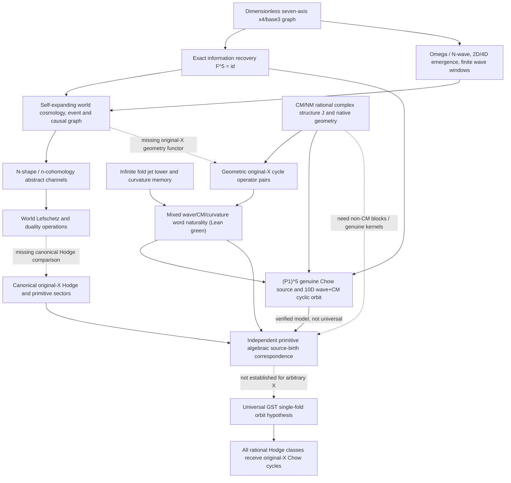

# GST fully connected proof-dependency graph: wave, n-cohomology, cosmology, CM, native curvature and Hodge

Date 2026-11-09 · Active branch `research/gpt6-native-point-primitive-span-20261017` · This is a dependency/status graph, **not** a theorem claiming that every arrow is already established.

## Contract at every edge

| From | To | Actual mathematical status |
|---|---|---|
| Seven-axis arithmetic | Exact F^5 local information | **Lean-proved**, the 12 physical carry/trit states and full stream recovery |
| Seven-axis arithmetic | Ω/N wave | **Lean-developed** on canonical perfect-power arithmetic sheets; not a statement about cohomology of every projective X |
| Waves and events | Unbounded cosmology | **Lean-developed** as types, causal paths and world-birth rules; algebraic geometry is optional supplied realization |
| World-cohomology channels | Canonical H^{2p}(X) | **Missing comparison**, needs actual rational Betti/cohomological grading, Hodge filtration and polarization |
| World Lefschetz | Cup by ample divisor | **Missing comparison**, the world-digit/carry nilpotent operator does not itself establish hard Lefschetz on X |
| CM/NM programs | Native actual original-X cycles | **Proved for supported realized programs**; universal existence of suitable CM data on every X is not supplied |
| Infinite JetTowerInf | Fold-curvature identities | **Lean-proved** as formal all-order convolution; no automatic analytically convergent infinite geometry |
| Actual original-X wave and CM operators | Single combined fold and mixed curvature word | **Lean kernel green** as soon as both are genuine cycle-operator pairs |
| Combined fold T=S+J | Q^8 cyclotomic plus CM model | **Exact Wolfram and elementary field proof** of cyclicity; determinant 541 |
| Combined fold T=S+J | X=(P1)^5, codim2, actual Chow correspondence | **Complete hand-geometric construction**, exact Wolfram cyclic determinant 10,292,525 |
| Every codimension of X=(P1)^5 | One actual Chow correspondence seed orbit per weight | **Constructively shown** via complementary monomial cycles; dimensions 1,5,10,10,5,1 |
| Actual original-X native words | The existing algebraic image | **Lean kernel proved**: cannot produce a missing quotient direction by replaying only those words |
| Geometry-specific primitive source-birth | Arbitrary-X GST cyclic hypothesis | **The genuine target of the proof attempt**: construct new correspondence source for each primitive direction independent of knowing its Chow representative |

## Why the low-dimensional Hodge proof DOES enter

On all smooth projective complex d-folds, classical Lefschetz (1,1) plus hard Lefschetz shows the entire Hodge problem reduces to primitive middle-type sectors where divisor/hyperplane sources no longer suffice. Therefore the legitimate goal of the world wave/Lefschetz dictionary is to land on primitive rational Hodge pieces with genuine geometric Chow operators; a matching numeral n or grade index in abstract GST channels does not suffice.

The new 10-dimensional model uses an actual **fivefold**, not a 5D assignment to the seven axes. The five is the dimension of X as an independent algebraic realization; the seven axes remain dimensionless.

## The exact obstruction to naive full synthesis

On `GSTGraphV2CMNMCoupledUniverse`, arithmetic transitions leave the geometry node unchanged, while certified geometric transitions preserve existing algebraic witnesses. Hence the currently implemented *product coupling* by itself does not show that an arithmetic information period generates a new geometric Hodge direction. The new verified `combinedWaveCM` and `word_cycleClass` theorems correctly define how a geometric wave operator WOULD interact when constructed, and the fivefold genuine Chow example shows that nontrivial geometric realization is possible. The required new general GST map must be **interaction-bearing**, not merely a Cartesian product of independent graphs.

Source conservation is a theorem, not pessimism: every actual original-X Chow correspondence word sends the existing cycle-class image into itself. To make the orbit complete, the geometric construction must cover all primitive Hodge directions by actual new native sources.

## Key artifacts

- `GSTGraphV2IntegratedWaveCMGate.lean`: mixed words and single combined fold, rank-one CM compatibility boundary; run 42663099970 **SUCCESS**.
- `research/computations/gst_cm_wave_single_fold_cyclotomic8_20261109.wl`: exact 8D field/cyclic generator.
- `research/computations/gst_cm_wave_chow_fivefold_codim2_20261109.wl`: actual 10-subset intersection matrix, exact rank-10 operator.
- `research/records/2026-11-09-gst-wave-cm-chow-fivefold-codim-two-full-cyclic-geometric-proof.md`: original-X Chow construction in all weights.
- `research/records/2026-11-09-gst-entire-wave-cm-curvature-ncohomology-hypothesis-attack.md`: alphaXiv-extracted literature comparison and complete proof attempt.
