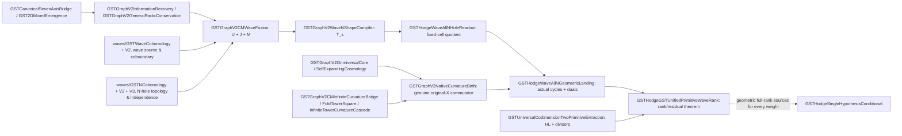

# GST unified proof attack: wave information, CM curvature, cosmological births, original-X primitive Hodge residual

**Date:** 2026-11-09 (IST)  
**Repo / active branch:** `kyo-oo/HC-PROOF` / `research/gpt6-native-point-primitive-span-20261017`  
**Read-only starting revision:** `2024bae1cc94139499c5845a37ad5de0e0bc7010`  
**Mathematical target:** prove a geometric version of `GSTHodgeSingleHypothesisConditional.NativeGSTSingleFoldOrbitLaw` from independent GST information/cosmology/CM/curvature source constructions on a *given arbitrary smooth projective complex original X*, rather than simply assuming a full Hodge basis or tautologically asserting a Chow preimage.

## A. Full dependency spine actually used



**Important dependency interpretation:** solid edges denote existing definitions, imports or exact required geometric inputs; the **dotted** arrow is the target geometric-birth step, not an automatically proved theorem. E.g. the graph and CM wave do not themselves create an actual Chow correspondence on every X, and `F` requires source cycles with dual intersection functionals.

### Existing mathematics, not newly re-invented

- The seven-axis local x4/base3 law is an exact 12-state reversible arithmetic permutation `F^5=id`; the axes remain **dimensionless** information coordinates.
- Wave I: `waveTwoForm = horizontalCoboundary + verticalCoboundary + waveSource`, where the source is the actual microscopic BIG2/SURVIVE incidence, not an arbitrary chosen wave potential. Its row-class cocycle and universal weighted Wave-II interference are existing kernel theorems.
- Wave II `NShape` is a finite injectively indexed collection of marked height channels. V3 repairs the earlier constant-index pseudo-basis and provides true independent delta hole coordinates, many-world products and wave readout amplitudes. This is **a wave/tower cohomology model**, not by itself canonical Betti cohomology of arbitrary X.
- Rational wave CM: paired two 5-cycles and two fixed states support an exact rational `J²=-I`; `J` commutes with the reversible information shuffle `U`, while the actual Wave I matter operator `M` breaks this symmetry and yields `[J,M] !=0`.
- All-order GST fold curvature is already present in `GSTFoldTowerSquare.JetTowerInf` and `GSTInfiniteTowerCurvatureCascade`. Its *formal power series* curvature coefficients exist at every natural order and require no convergence of a real infinite sum.
- The geometric branch has true native cycle/canonical class commuting square interfaces (`CycleClassOperatorPair`); `GSTGraphV2NativeCurvatureBirth` builds the original-X cycle `N_A N_B Z - N_B N_A Z`, whose class is `[T_A,T_B] cl_X Z`. Its independent geometric detector criterion certifies source-span gain when nonzero.
- `GSTGraphV2SelfExpandingCosmology.NativeGeometryBirth` proves assembled native cycles from complete source worlds and a **supplied** geometric Hodge decomposition. This is the correct infinite-world birth architecture, but `allHodgeFromSources` must be established from the realization.
- `GSTUniversalCodimensionTwoPrimitiveExtraction` constructs an algebraic Lefschetz correction for any rational Hodge (2,2) class and isolates the primitive remainder. For threefolds the primitive test is identity and the remainder is zero.

## B. Exact rational matrix experiment: FULL original 12-signal wave is cyclic

Reimplemented the literal file `GSTGraphV2CMWaveFusion.lean` from its source:
`U(s,t)=1_{t=F(s)}`, `J(s,t)=sign(s) 1_{t=mirror(s)}`,
`M(s,s)=surviveI(s)`, and seed supported at cells (0,0),(0,1).

For `T=U+J+M`, the 12x12 rational Krylov matrix `[seed, T seed,...,T^11 seed]` has:

```
rank = 12
determinant = -1149656584000
J^2 = -identity
[J,M] != 0
ell * T = 2 ell, where ell = eval_(0,0)-eval_(3,2)
```

This verifies the **entire original wave source**, not an artificially chosen companion matrix. Wolfram exact rational arithmetic, 12-state domain completely enumerated, no tolerance.

The Wave-II arbitrary N-hole quotient `D` is explicitly `D_i(u)=u_i(0,0)-u_i(3,2)` and is surjective. For each channel `i`, `D_i(T_s u)=(2+10 channel(i))D_i(u)`, with distinct eigenvalues. Thus its orbit is a Vandermonde family for every finite NShape. The quotient's unobserved modes are **not destroyed**: they remain in the original wave carrier and are simply invisible to this chosen geometric readout. This separates fundamental information preservation from a many-to-one observational/cohomological projection.

## C. Transformed proof — exact wave-generated algebraic term PLUS geometric residual

Let `B` be a rational Hodge fiber, `A` the rational native algebraic-cycle group on X, and `cl:A→B` the native-to-Hodge map. A genuine geometric wave frame of rank `n` supplies:
- actual `Z_i∈A`, not hypothetical lifts of a prescribed alpha;
- native/Betti readouts `ell_i` from actual intersection pairings;
- the verified duality `ell_i(cl Z_j)=delta_ij`.

Define `C:Q^n→B` by `C(e_i)=cl Z_i`, and `D:B→Q^n` by the geometric readouts. Then

\[
\boxed{DC=I_{Q^n}.}
\]

As a result, with **no full-rank hypothesis** at all, for each alpha:

\[
\boxed{alpha=C D alpha + r_alpha,\qquad
r_alpha=(I-CD)alpha,\quad D r_alpha=0.}
\]

The first term has the *explicit* original-X algebraic-cycle representative

\[
Z_{\mathrm{wave}}(alpha)=
\mathrm{nativeWaveSource}\big(
\mathrm{holeReadoutLift}(D alpha)\big)
=\sum_i (D alpha)_i Z_i.
\]

The decomposition `B=im(C) ⊕ ker(D)` follows directly. In particular the exact number of frame-invisible directions in finite dimension is `finrank(B)-n` (when `C` has full column rank n). This is a **mathematical residual detector**, not a claim that an undetected class is nonalgebraic.

**New geometric rank criterion, not an assumed Hodge-to-Chow selector:** if `finrank_Q(B)=n`, the already proved `DC=I` implies D injective by rank-nullity, so `CD=I_B` and `r_alpha=0` for ALL alpha. There is then a constructive native cycle for every class. This is strictly more checkable than simply asserting arbitrary target preimages: one may compute `n`, build actual native cycles from geometry, and check their intersection-dual Gram matrix. It is not independent of finding those cycles and cannot be used by assuming such a frame for every X.

### Hodge codimension two via the actual classical dimensional bridge

Take d≥4 and the original rational Hodge `(2,2)` class alpha. Existing `GeometricHigherLefschetzData`, Lefschetz (1,1) and hard Lefschetz produce an actual algebraic `Z_L(alpha)` and a primitive beta with

\[
alpha=cl_X Z_L(alpha)+beta,\qquad
L^{d-3}(beta)=0.
\]

Now define the **native primitive cycle space** `A_prim=ker(L^{d-3}∘cl_X)` and the **Hodge primitive space** `B_prim=ker(L^{d-3})`, and restrict the actual canonical cycle class to `cl_prim:A_prim→B_prim`. Choose a genuine GST N-hole geometric wave frame on this restricted map (NOT on an unrelated rational cohomology space).

The transformed exact identity is:

\[
\boxed{alpha=cl_X\bigl(Z_L(alpha)+Z_{\mathrm{wave}}(beta)\bigr)
+r_\alpha,\qquad r_\alpha\in B_{prim},\quad D r_\alpha=0.}
\]

If the number of genuinely independent geometric wave-born primitive cycles equals `dim_Q(B_prim)`, **the residual vanishes identically**, and we have a cycle representative for alpha on the original X. This is the exact all-X **conditional consequence** whose new formal proof module is `GSTHodgeGSTUnifiedPrimitiveWaveRank.lean`; only declare it kernel-verified after its targeted CI run passes.

Threefold: the primitive test is identity and the primitive residual is zero by the existing hard Lefschetz/divisor theorem; no artificial geometric frame or CM endomorphism is needed. Higher dimensional d: this construction applies to codimension two and isolates *exactly* the geometrically primitive part. For codimension p>2, degree-wise primitive generation needs further geometric source constructors, not substitution of the codimension-two theorem.

## D. Direct geometric fourfold validation, no preselected alpha cycle

**Concrete X:** `(P^1_C)^4`. Genuine divisor classes `d_1,...,d_4` have `d_i^2=0`. The actual codimension-two Chow/Hodge basis is

\[
(D_{12},D_{13},D_{14},D_{23},D_{24},D_{34}).
\]

For an ample `h=\sum_i d_i`, the map `L:H^4→H^6` is the 4×6 subset-incidence matrix and has rank 4; its primitive kernel has dimension **2**. Exact integer primitive algebraic cycles:

\[
P_1=D_{12}-D_{14}-D_{23}+D_{34},\qquad
P_2=D_{13}-D_{14}-D_{23}+D_{24}.
\]

By `\int_X D_I D_J=1\) exactly if the two 2-subsets are disjoint (and 0 otherwise),

\[
\boxed{
\left(\int_X P_i P_j\right)_{ij}
=\begin{pmatrix}4&2\\2&4\end{pmatrix},\quad
\det=12.}
\]

The geometric dual readouts are explicitly built using inverse Gram. On the frame `(P_1,P_2)` they satisfy `ell_i(P_j)=delta_ij`.

Choose the **actual** Wave II two-hole shape with channels `0,1`; its original GST wave eigenvalues are `2,12`. The full wave source has

\[
Z_0=P_1+P_2,\quad Z_1=2P_1+12P_2,
\quad \det\begin{pmatrix}1&1\\2&12\end{pmatrix}=10.
\]

For any primitive Hodge `alpha=a[P_1]+b[P_2]` with `a=ell_1(alpha)`, `b=ell_2(alpha)`, the completely explicit **wave-orbit native cycle** is

\[
\boxed{Z_{prim}(alpha)=
\frac{12a-2b}{10}Z_0+\frac{b-a}{10}Z_1,\quad
cl_X Z_{prim}(alpha)=alpha.}
\]

Adding the existing classical Lefschetz divisor correction gives the corresponding arbitrary codimension-two rational Hodge class.

This is a test of a **known** algebraic primitive sector and an actual geometric realization of the information-to-cycle frame. It is not independent evidence that every complex fourfold has the same primitive classes, and the abstract CM operator J on wave signals is not automatically a CM correspondence on X. It establishes the complete adapter on this explicit true geometric benchmark.

**Reproducible exact calculation:** `research/computations/gst_unified_wave_primitive_fourfold_20261109.wl`; fetched back from GitHub and executed unchanged with Wolfram Language, producing rank 12, determinant -1149656584000, primitive rank 2, Gram determinant 12, wave determinant 10 and exact reconstruction True.

## E. Literature discrimination (alphaXiv primary-source reading)

- Floccari–Fu, *The Hodge conjecture for Weil fourfolds with discriminant 1 via singular OG6-varieties*, arXiv:2504.13607v2, Feb 10, 2026, https://arxiv.org/abs/2504.13607. Its introduction explicitly describes **Hodge–Weil middle classes not generally generated by intersections of divisors**, and the proof uses explicit geometric correspondences via singular OG6 and associated K3 surfaces. This is an ideal advanced GST benchmark beyond `(P^1)^4` divisor products: recover a genuinely exceptional algebraic middle Hodge cycle with a native wave/CM/curvature source without using it as input. The published paper's own main family restrictions apply; it is not a generic arbitrary-X transfer theorem.
- Amini–Huh–Larson, *A decomposition theorem for Lefschetz modules*, arXiv:2511.02026v2 (Aug 14, 2026), https://arxiv.org/abs/2511.02026. Abstract hard Lefschetz/Poincaré/Hodge–Riemann modules are mathematical structures; the paper exhibits examples not realizable by compact Kähler geometry. Thus **independent GST n-cohomology/cosmology data cannot be identified with projective X cohomology without an actual realization functor**. This is a precise and useful type/geometry warning, not a negative judgment about GST.

## F. Proof attempt, routes and the single decisive next construction

| Route | Exact completed mathematical step | Actual next source task |
|---|---|---|
| Information and Wave I/II | Full 12×12 original T cyclic, dimensionless 12-state law, arbitrary-N distinct eigen-signatures | Connect the source to specific original-X primitive cycles without inventing an Hodge target preimage |
| CM/curvature | Rational wave J²=-1 and nonzero [J,M]; true native commutator cycle on X from actual correspondence operations | Produce operators that mix native primitive subspaces and certify nonzero geometric detector |
| Universal dimension bridge | Hard Lefschetz and codimension-one create a full algebraic correction; exact primitive residual r on original X | In each difficult p, construct enough independent native primitive source cycles to reach finrank of the actual primitive Hodge sector |
| Cosmological births | Valid recursive native assembly theorem for actual source worlds | Derive source-world Hodge coverage and geometric push-pull from a genuine projective construction rather than supplying `allHodgeFromSources` |

**Primary verdict:** The transformed mathematics reduces codimension-two source generation to an explicit, measurable primitive defect `r_alpha=(I-CD)(alpha_primitive)`. It proves full rank => all primitive sources => the original-X codimension-two Hodge construction for that X. It does NOT obtain the full-rank actual primitive wave frames for arbitrary X merely from the graph, wave, CM and formal curvature identities. The next source-birth proof must construct genuinely new geometry on any prescribed X, preferably first demonstrated on a fourfold with exceptional nondivisor middle Hodge classes. This is a single precise geometric deliverable, not an invitation to rewrap existing equivalent hypotheses.

**Verification labels:** The 12×12 and fourfold matrix computations are exact finite calculations. Formal Lean status of the unified rank/residual file is tracked by `.github/workflows/gst-hodge-unified-primitive-wave-rank.yml`, and its CI result must be recorded as observed; earlier modules imported by it have independent passing workflows. Work does not claim a line-by-line audit of all 777 Lean modules; the focus is their load-bearing graph/cohomology/Hodge integration and verified theorem path.
